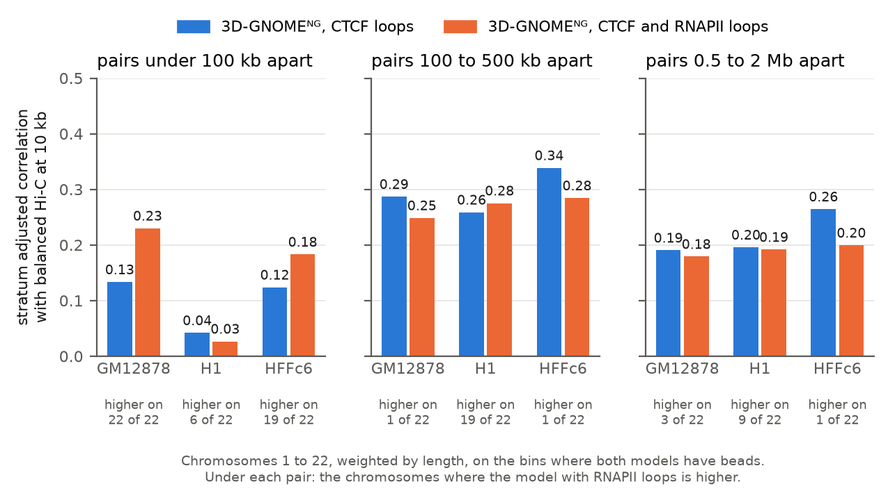
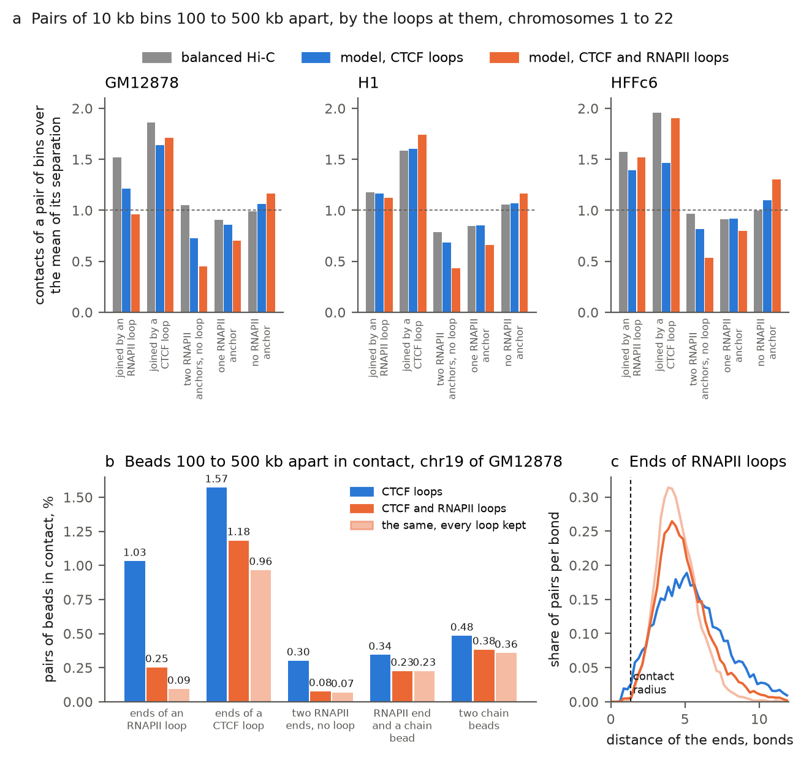
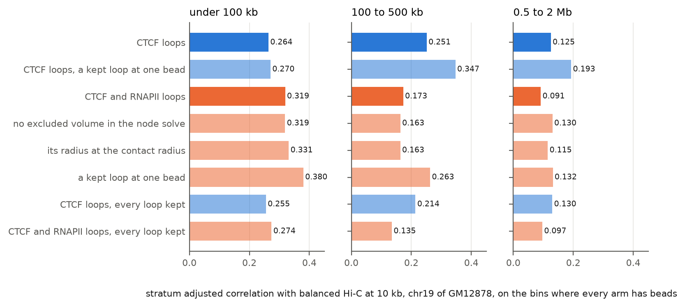

# RNAPII loops and the pairs 100 to 500 kb apart

A report of 2026-11-25. On the uniform chain the models with RNAPII loops agree with Hi-C better than the models
with CTCF loops for pairs under 100 kb apart and worse for pairs 100 to 500 kb apart. This note states the size
of the loss, the part of it that the measure makes, the cause in the model and the ways to remove it, each with
its numbers. Nothing in the model or on the site is changed.

Decided by the maintainer on 2026-11-25: no change. RNAPII loops are expected to lower the agreement with
Hi-C at this range. The loop target and the published score stay as they are.

## Summary

1. The loss is real on two cell lines of three. On the bins where both models have beads, against balanced Hi-C
   at 10 kb, the agreement of the pairs 100 to 500 kb apart moves by -0.041 on GM12878, by +0.015 on H1 and by
   -0.057 on HFFc6 with RNAPII loops added. On GM12878 and HFFc6 it is lower on 21 of 22 chromosomes.
2. The published form of the score overstates it. On chr19 of GM12878 the score over every bin against raw
   counts falls from 0.293 to 0.114. On the bins both models cover against balanced counts it falls from 0.251
   to 0.173. Two things make the difference: a bin without beads counts as a bin without contacts. The raw
   counts of a bin also grow with its coverage.
3. The cause is the distance at which the model holds a loop. A loop that a structure keeps is held by a spring
   at the distance of the law, 3 to 5 beads for a typical loop of this band. Two beads count as in contact
   within 1.33 bonds. The spring brings the two ends closer on average and keeps them out of contact: the ends of
   RNAPII loops are in contact in 1.03 % of pairs without the RNAPII loops, in 0.25 % with them and in 0.09 %
   when every loop is kept. Hi-C has 1.2 to 1.6 times the mean contacts at these pairs.
4. The excluded volume of the node solve is not the cause. Without it, or with its radius at the contact radius,
   the agreement of the band is 0.163 against 0.173. The beads that RNAPII loops add are not the cause: with
   every RNAPII loop dropped the model scores as the model with CTCF loops, 0.249 against 0.251.
5. With a kept loop held at one bead the loss is gone on chr19 of GM12878 and of HFFc6. On GM12878 the band
   rises from 0.173 to 0.263 with RNAPII loops and from 0.251 to 0.347 with CTCF loops alone. No band falls.
   On H1 the band rises on raw counts and falls on balanced counts. The cost is overlapping beads, 40 to 141
   per thousand against 3 to 6. The section on the ways to fix it has the options.
6. No other tool is ahead. On the bins where all three tools have beads the uniform chain is above cudaMMC and
   MultiMM in every band on every line, on raw and on balanced counts.

## Terms

- A node is a bead at an end of a loop that the structure keeps. The node solve, the arcs stage, places every
  node of a chromosome together. Every other bead is a chain bead. The smooth stage places the chain beads by
  Monte Carlo with the nodes fixed.
- The loop dropout keeps a loop of strength `q` in a structure with probability `q / (q + 1)`. The strength is
  the PET count of the loop over the typical count at its span. A typical loop is in half of the structures.
- The background is the distance of two beads without a loop, `(s / 1 kb) ^ nu` beads at the separation `s`. On
  GM12878 `nu` is 0.344 and the background is 4.9 beads at 100 kb, 6.7 at 250 kb and 8.5 at 500 kb.
- The loop target is the distance at which a spring holds a kept loop, `1 + (background - 1) / (1 + q)`. A
  typical loop is held halfway between one bead and the background: 2.9 beads at 100 kb, 3.8 at 250 kb and 4.7
  at 500 kb.
- The contact radius of every score is 1.33 bonds. A bond of the structures is 1.08 beads long.
- The score is the stratum adjusted correlation of the pooled contacts per bead pair with Hi-C at 10 kb, over
  the pairs of one band of separation. The Hi-C map is the half that no run read.
- The bins of both models are the 10 kb bins where the model with CTCF loops and the model with RNAPII loops
  both have beads. The uniform chain has beads inside the blocks of its loops. RNAPII loops add blocks, and
  chr19 of GM12878 has 40,256 beads with CTCF loops and 49,418 with RNAPII loops.

## The loss

The scores as the Results page computes them, over every bin against raw counts, chromosomes 1 to 22 weighted by
length. The three values of a cell are GM12878, H1 and HFFc6.

| Band | CTCF loops | CTCF and RNAPII loops |
|---|---|---|
| under 100 kb | 0.448, 0.388, 0.449 | 0.545, 0.424, 0.519 |
| 100 to 500 kb | 0.348, 0.307, 0.390 | 0.283, 0.284, 0.283 |
| 0.5 to 2 Mb | 0.147, 0.123, 0.203 | 0.137, 0.110, 0.146 |

At 25 kb the gain under 100 kb and the loss beyond it cancel. The Results page shows this as a p of 0.5. The
loss grows with the density of RNAPII loops of a chromosome, rank correlation -0.80 to -0.84. chr17 and
chr19 lose the most.

## The measure

Two properties of the score enlarge the loss.

A bin without beads holds zero contacts in a pooled map. The score over every bin compares that zero with
Hi-C. The two models have beads in different bins. The model with CTCF loops has beads in 64, 57 and 62 % of
the bins of the genome on the three lines and the model with RNAPII loops in more. A score over every bin
therefore compares two sets of bins as well as two structures.

The raw count of a cell grows with the coverage of its two bins. The bins with RNAPII anchors have the
highest coverage. Balanced counts remove it.

The same scores on the bins of both models that the balancing kept, against balanced counts, with the raw
counts beside them. `playground/rnapii/band_trace.py`, figure `band_problem`.

| Band | Counts | CTCF loops | CTCF and RNAPII loops | Mean change over chromosomes | Chromosomes higher with RNAPII loops |
|---|---|---|---|---|---|
| under 100 kb | balanced | 0.133, 0.042, 0.124 | 0.230, 0.027, 0.183 | +0.094, -0.013, +0.053 | 22, 6, 19 of 22 |
| under 100 kb | raw | 0.249, 0.186, 0.188 | 0.383, 0.227, 0.253 | +0.125, +0.037, +0.057 | 22, 18, 20 |
| 100 to 500 kb | balanced | 0.287, 0.259, 0.339 | 0.249, 0.275, 0.284 | -0.041, +0.015, -0.057 | 1, 19, 1 |
| 100 to 500 kb | raw | 0.207, 0.211, 0.308 | 0.131, 0.198, 0.231 | -0.077, -0.017, -0.080 | 0, 4, 0 |
| 0.5 to 2 Mb | balanced | 0.190, 0.196, 0.264 | 0.179, 0.192, 0.199 | -0.012, -0.005, -0.062 | 3, 9, 1 |
| 0.5 to 2 Mb | raw | 0.112, 0.145, 0.241 | 0.102, 0.138, 0.182 | -0.010, -0.005, -0.055 | 5, 7, 1 |

- The loss between 100 and 500 kb stays on GM12878 and HFFc6, on 21 of 22 chromosomes each, p 1e-06 by the
  signed rank test over chromosomes. It is half of its size over every bin.
- On H1 the band does not fall on balanced counts. It rises on 19 of 22 chromosomes.
- The gain under 100 kb stays on GM12878 and HFFc6. On H1 it is in the raw counts alone.
- HFFc6 also loses 0.06 between 0.5 and 2 Mb.
- chr19 of GM12878: 0.293 against 0.114 over every bin on raw counts, 0.251 against 0.173 on the bins of both
  models on balanced counts.

The scores of the Results page and of the tools comparison are over every bin against raw counts. They hold
this property for every arm and every tool. The section on the other tools has the comparison on the bins
that every tool covers.

## The pairs that lose contacts

The pairs of bins 100 to 500 kb apart fall into five classes by the loops at them. A pair is joined by a loop
when the two ends of the loop are within one bin of its two bins. The table has the contacts of a class over the
mean of its separation in balanced Hi-C and in the two models, chromosomes 1 to 22 on the bins of both models.
The last column has the contacts per thousand pairs of beads of the two models. Figure `band_pairs`, panel a.

| Class of pairs | Line | Hi-C | CTCF loops | CTCF and RNAPII loops | Contacts per 1,000 bead pairs |
|---|---|---|---|---|---|
| joined by an RNAPII loop | GM12878 | 1.52 | 1.22 | 0.96 | 11.3 to 7.9 |
| | H1 | 1.17 | 1.16 | 1.12 | 10.3 to 9.1 |
| | HFFc6 | 1.57 | 1.40 | 1.52 | 10.5 to 7.4 |
| joined by a CTCF loop | GM12878 | 1.86 | 1.64 | 1.71 | 12.8 to 11.6 |
| | H1 | 1.59 | 1.60 | 1.74 | 12.4 to 12.0 |
| | HFFc6 | 1.96 | 1.46 | 1.91 | 9.8 to 7.7 |
| two RNAPII anchors, no loop | GM12878 | 1.05 | 0.72 | 0.45 | 5.3 to 2.8 |
| | H1 | 0.79 | 0.69 | 0.43 | 4.5 to 2.5 |
| | HFFc6 | 0.97 | 0.82 | 0.53 | 5.2 to 2.2 |
| one RNAPII anchor | GM12878 | 0.91 | 0.86 | 0.70 | 6.0 to 4.4 |
| | H1 | 0.85 | 0.85 | 0.66 | 5.6 to 4.1 |
| | HFFc6 | 0.91 | 0.92 | 0.80 | 5.6 to 3.3 |
| no RNAPII anchor | GM12878 | 0.99 | 1.06 | 1.16 | 7.5 to 7.4 |
| | H1 | 1.06 | 1.07 | 1.16 | 7.2 to 7.2 |
| | HFFc6 | 1.00 | 1.10 | 1.31 | 6.6 to 5.3 |

- In Hi-C the pairs that a loop joins have 1.2 to 2.0 times the mean contacts and every other class is within
  0.8 to 1.1.
- With RNAPII loops added, the pairs that an RNAPII loop joins have fewer contacts than before on every line,
  by 11 to 30 %.
- The pairs of two RNAPII anchors that no loop joins lose half of their contacts. They are 6 % of the pairs of
  the band on GM12878 and 16 % on HFFc6.
- The pairs without an RNAPII anchor keep their contacts on GM12878 and H1 and lose a fifth on HFFc6. Their
  share of the contacts of the band rises. The model has them 16 to 31 % above the mean where Hi-C has them at
  the mean.

The model with RNAPII loops takes contacts away from the bins with RNAPII anchors, the pairs with a loop among
them. Hi-C has the most contacts at those pairs.

## The cause

Pairs of beads 100 to 500 kb apart on chr19 of GM12878, ten structures an arm, by the loop ends at the two
beads. `playground/rnapii/end_pair_contacts.py`, figure `band_pairs`, panels b and c. The spread of a pair is
the standard deviation of its distance over the structures over its mean.

| Pairs of beads | Arm | In contact, % | Median distance, bonds | Spread |
|---|---|---|---|---|
| ends of an RNAPII loop | CTCF loops | 1.03 | 5.27 | 0.27 |
| | CTCF and RNAPII loops | 0.25 | 4.64 | 0.23 |
| | the same, every loop kept | 0.09 | 4.33 | 0.15 |
| ends of a CTCF loop | CTCF loops | 1.57 | 4.06 | 0.21 |
| | CTCF and RNAPII loops | 1.18 | 4.04 | 0.19 |
| | the same, every loop kept | 0.96 | 3.92 | 0.13 |
| two RNAPII ends, no loop | CTCF loops | 0.30 | 6.88 | 0.24 |
| | CTCF and RNAPII loops | 0.08 | 6.77 | 0.20 |
| two chain beads | CTCF loops | 0.48 | 6.55 | 0.29 |
| | CTCF and RNAPII loops | 0.38 | 6.75 | 0.29 |

Three facts follow from the table.

A kept loop is not a contact. The spring of a loop holds its two ends at the loop target, 2.9 to 4.7 beads for
a typical loop of this band. It acts against a shorter distance as against a longer one. With the RNAPII
loops the ends are 12 % closer at the median and four times less often in contact. With every loop kept they
are 18 % closer and eleven times less often in contact. The ends of an RNAPII loop touch less often than two
chain beads at the same separation, 0.25 % against 0.38 %.

The strength of a loop is counted twice. The dropout turns the strength into the share of structures that hold
the loop. The loop target turns the same strength into the distance of the loop in those structures. A typical
loop is in half of the structures and is held halfway to the background in them. Its two ends are not held in
contact.

A node touches other nodes less often than a chain bead touches a chain bead. Two RNAPII ends without a loop
between them are in contact in 0.08 % of pairs against 0.38 % for two chain beads, at the same median distance.
The solve places the nodes at their targets with a small spread. The chain between them moves by Monte
Carlo. RNAPII loops raise the nodes of a structure of chr19 from about 1,290 to about 3,650.

The model with RNAPII loops has more nodes and more springs at a distance beyond contact. The contacts of the
band move to the chain beads far from every anchor. Hi-C has them at the anchors.

## Tests of the cause

Arms on chr19 of GM12878, ten structures each on one workstation, `slurm/ensemble/trace_arcs_arm.sh`. Each arm
changes the keys of its row in the config of the genome runs. The scores are on the bins of both models that
the balancing kept, against balanced counts, with the raw counts of the band beside them. Figure `band_arms`.

| Arm | Under 100 kb | 100 to 500 kb | 0.5 to 2 Mb | 100 to 500 kb, raw |
|---|---|---|---|---|
| CTCF loops, the genome run | 0.264 | 0.251 | 0.125 | 0.154 |
| CTCF and RNAPII loops, the genome run | 0.321 | 0.175 | 0.099 | 0.059 |
| CTCF and RNAPII loops, the control on the workstation | 0.319 | 0.173 | 0.091 | 0.060 |
| no excluded volume in the node solve, `apply_to_arcs = no` | 0.319 | 0.163 | 0.130 | 0.066 |
| its radius at the contact radius, `radius_arcs = 1.33` | 0.331 | 0.163 | 0.115 | 0.066 |
| CTCF loops, every loop kept | 0.255 | 0.214 | 0.130 | 0.116 |
| CTCF and RNAPII loops, every loop kept | 0.274 | 0.135 | 0.097 | 0.028 |
| a kept loop at one bead, `contact_half_saturation = 0.001` | 0.380 | 0.263 | 0.132 | 0.233 |
| CTCF loops, a kept loop at one bead | 0.270 | 0.347 | 0.193 | 0.300 |
| RNAPII loops all dropped, their beads kept, `factor_strength = 1,0` | 0.272 | 0.249 | 0.136 | 0.140 |
| every loop kept, the RNAPII loops held at the background, `factor_strength = 1,0` | 0.228 | 0.139 | 0.077 | 0.016 |

- The control repeats the genome run, 0.173 against 0.175.
- The excluded volume of the node solve was the first suspect: its radius, 2.88 beads here, is above the
  contact radius. Without it the contacts of the band rise from 2.4 to 3.1 per thousand pairs of beads and the
  agreement does not, 0.163.
- More kept loops lower the band. Every loop kept takes 0.04 from both models.
- The beads that RNAPII loops add are not the cause. With every RNAPII loop dropped the chain keeps the beads of
  the model with RNAPII loops and scores as the model with CTCF loops, 0.249 against 0.251.
- The pull of an RNAPII loop is not the cause either. With every loop kept and the RNAPII loops at strength 0,
  a spring holds the two ends of an RNAPII loop at the background. The band is 0.139 against 0.135 with the pull.
  The CTCF loops alone have 0.214. The two ends are then in contact in 0.01 % of pairs. A spring at a
  distance beyond contact takes its pair out of contact at any target. The pull adds the gain under 100 kb,
  0.228 to 0.274.
- With `contact_half_saturation` at 0.001 every loop target is one bead and the radius of the excluded volume,
  which the run derives from the mean loop target, is 1.0. The ends of the RNAPII loops are then in contact in
  16 % of pairs and those of the CTCF loops in 19 %. The band rises by 0.09 with RNAPII loops and by 0.10 with
  CTCF loops alone. The two other bands rise as well.
- At one bead the classes of pairs without a loop match Hi-C: 0.90, 0.88 and 0.95 of the mean against 0.96,
  0.91 and 1.04. The pairs with a loop are above it, 1.98 against 1.25 for the RNAPII loops and 2.18 against
  1.58 for the CTCF loops.
- Between 100 and 500 kb the model with RNAPII loops stays below the model with CTCF loops under the same rule,
  0.263 against 0.347. Under 100 kb it is above it, 0.380 against 0.270.

The whole chromosome at 25 kb, the score of the Results page, with the measures of the battery:

| Arm | SCC per bead pair, raw | balanced | Distance exponent over Hi-C | Overlaps of chain beads per 1,000 | Overlaps of anchors per 1,000 |
|---|---|---|---|---|---|
| CTCF loops | 0.563 | 0.457 | 1.19 | 6.2 | 0.2 |
| CTCF and RNAPII loops | 0.417 | 0.422 | 1.12 | 5.1 | 1.3 |
| no excluded volume in the node solve | 0.415 | 0.418 | 1.13 | 7.5 | 2.3 |
| its radius at the contact radius | 0.422 | 0.423 | 1.12 | 7.1 | 1.8 |
| a kept loop at one bead | 0.528 | 0.467 | 0.91 | 140.6 | 20.3 |
| CTCF loops, a kept loop at one bead | 0.593 | 0.466 | 1.07 | 64.5 | 3.2 |

An overlap is a pair of beads that are not chain neighbours closer than 0.7 of a bond. A kept loop at one bead
raises the agreement at 25 kb and brings the distance exponent to within 10 % of Hi-C. It also packs the chain
at the ends of the loops: 141 chain beads per thousand overlap against 5.

### The overlaps of the contact arm

With every loop target at one bead the run derives a radius of the excluded volume of 1.0 from the mean loop
target. Three more arms separate the loop target from that radius. `contact_r288` holds the radius at 2.88, its
value in the model of today. `half01` has `contact_half_saturation = 0.1`: a typical loop of the band is held
at 1.2 to 1.7 beads, near the contact radius. The derived radius is 1.37.

| Arm | Under 100 kb | 100 to 500 kb | 0.5 to 2 Mb | 25 kb, whole chromosome, raw | Distance exponent over Hi-C | Overlaps of chain beads per 1,000 | Overlaps of anchors per 1,000 |
|---|---|---|---|---|---|---|---|
| CTCF and RNAPII loops | 0.319 | 0.173 | 0.091 | 0.417 | 1.12 | 5.1 | 1.3 |
| a kept loop at one bead, radius 1.0 | 0.380 | 0.263 | 0.132 | 0.528 | 0.91 | 140.6 | 20.3 |
| a kept loop at one bead, radius 2.88 | 0.385 | 0.289 | 0.132 | 0.536 | 0.94 | 85.9 | 11.3 |
| a kept loop near the contact radius, radius 1.37 | 0.378 | 0.257 | 0.133 | 0.506 | 0.98 | 57.9 | 8.3 |
| CTCF loops | 0.264 | 0.251 | 0.125 | 0.563 | 1.19 | 6.2 | 0.2 |
| CTCF loops, a kept loop at one bead, radius 1.0 | 0.270 | 0.347 | 0.193 | 0.593 | 1.07 | 64.5 | 3.2 |
| CTCF loops, a kept loop at one bead, radius 2.88 | 0.273 | 0.344 | 0.187 | 0.595 | 1.08 | 56.0 | 2.3 |

- The radius of today with the loops at one bead keeps the gain, 0.289 in the band. It lowers the overlaps
  from 141 to 86 per thousand.
- A loop target near the contact radius keeps the gain as well, 0.257, with 58 overlaps per thousand. The ends
  of RNAPII loops are then in contact in 5 % of pairs against 16 %.
- No arm with a short loop target has the overlaps of today, 5 per thousand. The overlaps follow the loop
  target more than the radius of the node solve. Their place on the chain is not measured.

## The same arms on two other lines

A kept loop at one bead on chr19 of HFFc6 and of H1, ten structures an arm, beside the genome runs of the two
lines and the arms of GM12878. The scores of the bands are on the bins of both models that the balancing kept.

| Line | Arm | Under 100 kb | 100 to 500 kb | 0.5 to 2 Mb | 100 to 500 kb, raw | 25 kb, whole chromosome, raw | Distance exponent over Hi-C | Overlaps of chain beads per 1,000 |
|---|---|---|---|---|---|---|---|---|
| GM12878 | CTCF loops | 0.264 | 0.251 | 0.125 | 0.154 | 0.563 | 1.19 | 6.2 |
| | CTCF loops, a kept loop at one bead | 0.270 | 0.347 | 0.193 | 0.300 | 0.593 | 1.07 | 64.5 |
| | CTCF and RNAPII loops | 0.319 | 0.173 | 0.091 | 0.060 | 0.417 | 1.12 | 5.1 |
| | CTCF and RNAPII loops, a kept loop at one bead | 0.380 | 0.263 | 0.132 | 0.233 | 0.528 | 0.91 | 140.6 |
| HFFc6 | CTCF loops | 0.191 | 0.309 | 0.174 | 0.252 | 0.521 | 1.40 | 4.4 |
| | CTCF loops, a kept loop at one bead | 0.182 | 0.393 | 0.279 | 0.379 | 0.554 | 1.11 | 81.0 |
| | CTCF and RNAPII loops | 0.256 | 0.243 | 0.187 | 0.163 | 0.334 | 1.28 | 2.7 |
| | CTCF and RNAPII loops, a kept loop at one bead | 0.265 | 0.336 | 0.223 | 0.321 | 0.447 | 0.97 | 44.5 |
| H1 | CTCF loops | 0.080 | 0.319 | 0.134 | 0.198 | 0.461 | 1.36 | 5.2 |
| | CTCF loops, a kept loop at one bead | 0.059 | 0.299 | 0.162 | 0.276 | 0.472 | 1.17 | 40.5 |
| | CTCF and RNAPII loops | 0.092 | 0.331 | 0.078 | 0.142 | 0.256 | 1.20 | 3.8 |
| | CTCF and RNAPII loops, a kept loop at one bead | 0.087 | 0.266 | 0.128 | 0.264 | 0.374 | 1.00 | 47.6 |

- HFFc6 repeats GM12878. The band rises by 0.09 with RNAPII loops and by 0.08 with CTCF loops alone. The model
  with RNAPII loops at one bead is above the model with CTCF loops of today in every band.
- On H1 the two counts disagree. On raw counts the band rises by 0.12 and by 0.08. On balanced counts it falls
  by 0.07 and by 0.02. H1 is the line without the loss. Its scores under 100 kb on balanced counts are 0.06
  to 0.09, a third of the other lines.
- The score of the whole chromosome at 25 kb rises on every line, by 0.11 to 0.12 with RNAPII loops and by 0.01
  to 0.03 with CTCF loops alone.
- The distance exponent moves from 1.12 to 1.40 times that of Hi-C to 0.91 to 1.17 times.
- The overlaps of chain beads rise on every line, from 3 to 6 per thousand beads to 40 to 141.
- Between 100 and 500 kb the model with RNAPII loops stays below the model with CTCF loops under the same rule
  on every line, by 0.03 to 0.08.

## Ways to fix it

Each option states its evidence and its open part. A change of the model is the decision of the maintainer.

1. Keep the model and change the score. The agreement is stated on the bins that both models cover, against
   balanced counts. The loss between 100 and 500 kb is then 0.04 on GM12878 and 0.06 on HFFc6 in place of 0.07
   and 0.11. H1 gains 0.015. The loss remains.
2. Turn off the excluded volume of the node solve or lower its radius. Measured: no gain in the band, 0.163
   against 0.173. Not a fix.
3. Hold a kept loop at contact. Under the dropout the strength of a loop is the share of structures that hold
   it. In those structures the loop target is one bead for every loop. Measured with an existing key on chr19
   of three lines. On GM12878 and HFFc6 the band rises by 0.08 to 0.10 for both models and no band falls by more
   than 0.01. On H1 it rises on raw counts and falls by 0.02 to 0.07 on balanced counts. The score at 25 kb
   rises by 0.11 with RNAPII loops and by 0.01 to 0.03 with CTCF loops alone on every line. Open: the overlaps,
   40 to 141 per thousand beads against 3 to 6. The pairs with a loop have 2.0 to 2.2 times the mean contacts
   against 1.3 to 1.6 in Hi-C. One chromosome a line, ten structures.
4. Hold a kept loop at one bead and keep the radius of the excluded volume of today, 2.88. Measured on chr19
   of GM12878: the band is 0.289, the highest of the arms with RNAPII loops. The overlaps are 86 per thousand
   in place of 141. With a loop target near the contact radius the band is 0.257 with 58 overlaps. Open: the
   overlaps stay ten times those of today. The smooth stage and the cross block relaxation own the overlaps of
   chain beads. A fix by option 3 or 4 needs a rule for the chain at the ends of a closed loop.
5. Take the ends of RNAPII loops out of the node solve. The nodes stay those of the CTCF loops and an RNAPII
   loop acts on its two chain beads in the smooth stage. Not built: the smooth stage has no term between two
   chain beads of a loop. It would keep the band of the model with CTCF loops. The gain under 100 kb is open.
6. Let the nodes move in the last pass with their loops as springs. Not built. It addresses the small spread of
   the nodes, the third fact of the cause.

## The other tools

On the tools comparison, chr1 1 to 60 Mb with CTCF loops, ten structures a tool, on the bins where all three
tools have beads, against balanced counts. The three values are GM12878, H1 and HFFc6.

| Band | 3D-GNOMEᴺᴳ | cudaMMC | MultiMM |
|---|---|---|---|
| under 100 kb | 0.241, 0.181, 0.238 | 0.093, 0.021, 0.048 | 0.104, 0.025, 0.023 |
| 100 to 500 kb | 0.430, 0.429, 0.495 | 0.195, 0.161, 0.232 | 0.179, 0.115, 0.130 |
| 0.5 to 2 Mb | 0.290, 0.221, 0.287 | 0.100, 0.078, 0.089 | 0.073, 0.020, 0.062 |

The uniform chain is above both tools in every band on every line, on raw counts as well. Over the genome, on
the bins where cudaMMC and both models have beads, the band of 100 to 500 kb is 0.388, 0.379 and 0.467 with
CTCF loops, 0.346, 0.380 and 0.439 with RNAPII loops and 0.214, 0.150 and 0.253 for cudaMMC on balanced counts.
cudaMMC is above the model with RNAPII loops on no chromosome of any line. On raw counts it is above it on 13
of 22 chromosomes of GM12878, 0.254 against 0.236. It is above it on no chromosome of the two other lines.

## Not measured

- The contact arm on other chromosomes, on a chromosome with few RNAPII loops and with twenty structures.
- The overlaps of the contact arm by their place on the chain.
- The panels on RNAPII loops under a kept loop at one bead: the enhancer to promoter distance, its link to
  expression and the Micro-C loops placed.
- The cause of the gain on H1 between 100 and 500 kb.
- The score of the Results page on the bins that an arm covers, for every arm and tool.

## Files

- `playground/rnapii/band_trace.py`: the scores on the bins of every arm and the classes of pairs.
- `playground/rnapii/end_pair_contacts.py`: the contacts and the spread of pairs of beads.
- `playground/rnapii/fig_band_trace.py`: the figures.
- `slurm/ensemble/trace_arcs_ev.sh`, `trace_arcs_arm.sh`, `trace_arcs_ev_score.sh`: the arms and their scores.
- `design/figures/trace-2026-11-25/`: the figures. The tables per chromosome and per arm are in
  `data/figures/trace-2026-11-25/`.
